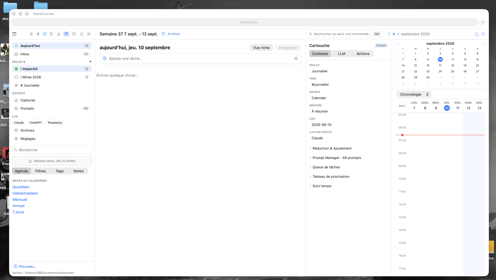

# PAT-005 — NoteCortex — Cockpit blanc à quatre colonnes

Statut : design observé sur capture utilisateur et code SwiftUI lu ; exécution non testée. Date : 2026-09-10.

## Référence visuelle

Capture fournie par l’utilisateur : « Capture d’écran 2026-09-10 à 06.46.36.png ». Copie conservée sans modification. Elle contient des noms de projets et des éléments du bureau : vérifier ces informations avant toute diffusion publique.

## Problème et intention
Écrire une note ou organiser sa journée tout en gardant accessibles la navigation, le contexte de la note et le calendrier.

## Composition réutilisable

| Zone | Rôle | Repère dans ContentView.swift |
| --- | --- | --- |
| Navigation gauche | Aujourd’hui, inbox, projets, captures, prompts, recherche, dépôt et vues | sidebar, ligne 690 ; sidebarCockpit, ligne 805 |
| Éditeur central flexible | Titre, tâches et texte ; bascule texte/vue riche | editeur, ligne 1493 |
| Inspecteur Cartouche | Contexte, LLM, Actions et sections dépliables | cartoucheCockpit, ligne 1669 |
| Calendrier droit | Mois, choix Chronologie/Journée, grille temporelle | panneauDroite, ligne 2685 |

L’assemblage est dans `vueNotePlan`, ligne 322 : HStack sans espacement, séparateurs Divider et éditeur extensible. Les constantes déclarent 300 points pour la navigation, 300 pour la cartouche et 340 pour le calendrier. Ce sont des points de mise en page SwiftUI, pas des pixels mesurés sur la capture.

## Style à conserver

- Surfaces claires utilisant les couleurs système textBackgroundColor, controlBackgroundColor et windowBackgroundColor.
- Texte principal sombre, légendes secondaires grises et accents bleus visibles sur la capture.
- Séparateurs fins ; sélection légèrement teintée ; boutons, badges et sélecteurs compacts à coins arrondis.
- Grand espace central pour écrire ; outils secondaires dans les panneaux latéraux.
- Choix de thème dans le code, ligne 209 : sombre si prefs.theme vaut 2, clair sinon.

## Mécaniques repérées dans le code

- Les onglets Contexte / LLM / Actions changent le contenu de la cartouche via ongletCartouche.
- Les groupes dépliables incluent Réduction & Ajustement, Prompt Manager, Queue de tâches, Tableau de priorisation et Suivi temps.
- Le bouton Vue riche/Texte bascule journeeTexteLibre. Le passage à la vue riche est bloqué si le texte contient des modifications non enregistrées.
- Enregistrer appelle enregistrerNote() ; raccourci Commande-S ; bouton désactivé sans modification et masqué en lecture seule dans le code examiné.
- enregistrerNote() vérifie la lecture seule, appelle la commande ecrire et expose une erreur en cas d’échec. L’écriture n’a pas été exécutée pendant cette analyse.
- Le calendrier propose Chronologie/Journée. Une sélection de date déclenche chargerCible().
- La zone de dépôt a un gestionnaire traiterElementsDeposes ; les effets de dépôt restent à tester.

## Combiner avec d’autres designs

Propositions de transposition, non implémentées :

1. Conserver les quatre rôles comme modules indépendants : navigation, contenu, inspecteur et temps.
2. Appliquer une autre palette ou typographie en gardant les états de sélection, erreur, lecture seule et modification explicites.
3. Réutiliser la cartouche avec une liste, une fiche ou un dashboard ; son contexte doit suivre l’objet sélectionné.
4. Sur une fenêtre étroite, proposer de masquer ou ouvrir à la demande les panneaux secondaires. Le code observé utilise des largeurs fixes ; cette adaptation reste à concevoir et tester.
5. Ajouter une mécanique externe seulement si elle sert une tâche identifiée et conserve l’accès clavier.

## Source et traçabilité

- Dépôt source : [bizc0m/NoteCortex](https://github.com/bizc0m/NoteCortex).
- Révision locale lue : `3ae184c11c2f99511fe2fc6fc3ccd01588965db3`.
- [ContentView.swift à cette révision](https://github.com/bizc0m/NoteCortex/blob/3ae184c11c2f99511fe2fc6fc3ccd01588965db3/mac/Sources/NoteCortexMac/ContentView.swift).
- Chemin source local : `/Users/JOB/#DEV/02-apps/NCTx/NoteCortex/mac/Sources/NoteCortexMac/ContentView.swift`.
- Sources primaires de cette fiche : capture utilisateur et lecture du code local. Disponibilité du lien distant à cette révision non vérifiée ici.
- Aucun code source copié dans la bibliothèque. Licence et dépendances à vérifier avant extraction de composants vers un autre projet.

## Confiance et limites

Élevée pour la composition visible et les branchements explicitement lus ; correspondance exacte entre le binaire capturé et cette révision non établie. La capture montre un bouton Enregistrer grisé alors que le pied de fenêtre indique lecture : le code lu masque ce bouton en lecture seule. Cet écart doit être vérifié avant reproduction exacte. Aucun build, lancement ou test de parcours effectué pour cette fiche.

## Checklist de recette pour une réutilisation

- [ ] Tester les quatre panneaux avec contenu réel long et fenêtre réduite.
- [ ] Naviguer au clavier et vérifier le focus dans chaque panneau.
- [ ] Vérifier sélection de note/date et contexte de la cartouche.
- [ ] Modifier puis enregistrer une note de test et contrôler le résultat sur disque.
- [ ] Vérifier le blocage de bascule vers la vue riche avec modifications non enregistrées.
- [ ] Tester lecture seule, erreur d’écriture et annulation sans perte de contenu.
- [ ] Tester dépôt sur des fichiers de démonstration.
- [ ] Vérifier contraste, zoom et affichage des états actifs/désactivés.

## Fiches liées

- [UX-033 — Conserver le contexte](../10_Dashboards/UX-033.md)
- [UX-026 — Accomplir la tâche au clavier](../08_Accessibilite/UX-026.md)
- [UX-022 — Adapter la disposition](../07_Mobile-Responsive/UX-022.md)
- [Template de recette](../99_Templates/RECETTE-UX.md)

[Patterns projets](INDEX.md) · [Catalogue global](../INDEX.md)
